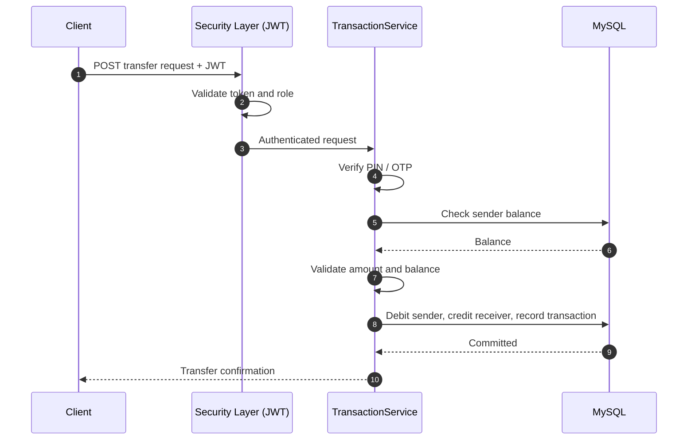
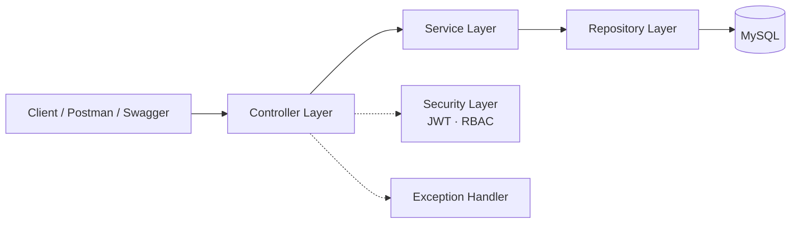

<div align="center">

  

  # LeanBackend

  ### Secure Fintech & Digital Wallet System

  A secure, organization-oriented digital payment and wallet platform built with **Java** and **Spring Boot**.

  <br/>

  
  
  
  

  
  
  
  
  
  

  <br/><br/>

  [Overview](#-overview) · [Features](#-core-features) · [Architecture](#-architecture) · [API](#-api-reference) · [Setup](#-getting-started) · [Roadmap](#-roadmap)

</div>

---

## 📌 Overview

**LeanBackend** is a backend-focused fintech application that provides a secure digital payment environment for authorized users within an organization.

Users can register, authenticate, manage wallet accounts, transfer funds, and monitor their transactions through RESTful APIs. The project emphasizes **secure authentication and authorization**, **reliable transaction handling**, and a **clean, maintainable layered architecture**.

| | |
|---|---|
| 🔐 **Secure by design** | JWT, OTP verification, PIN-protected transfers, RBAC |
| 💸 **Reliable transfers** | Server-side validation of amounts and balances |
| 🧱 **Maintainable** | Layered architecture with clear separation of concerns |
| 📘 **Documented & tested** | Swagger docs, Postman collections, JUnit &amp; Mockito tests |

---

## ✨ Core Features

<table>
  <tr>
    <td width="50%" valign="top">

### 🔐 Authentication & Security
- User registration and login
- JWT-based stateless authentication
- OTP-based account verification
- Password encryption with Spring Security
- Role-based access control (RBAC)
- Protected REST endpoints

    </td>
    <td width="50%" valign="top">

### 💰 Digital Wallet
- Create and manage wallet accounts
- Retrieve wallet balance
- Deposit funds
- Transfer money between authorized users
- Validate amounts and available balance

    </td>
  </tr>
  <tr>
    <td width="50%" valign="top">

### 📊 Transactions
- Record every financial transaction
- Track sender and receiver details
- Full transaction history
- Transaction summaries

    </td>
    <td width="50%" valign="top">

### 👤 User Management
- Organization-specific registration
- Profile and account management
- Role assignment and authorization
- Account status management

    </td>
  </tr>
</table>

---

## 🔄 How a Transfer Works



---

## 🏗️ Architecture

The application uses a **layered architecture** to keep concerns separated and the codebase easy to extend and test.



| Layer | Responsibility |
|---|---|
| **Controller** | Handles HTTP requests and API responses |
| **Service** | Business logic and application workflows |
| **Repository** | Database access via Spring Data JPA |
| **Entity** | Database entities and relationships |
| **DTO** | Structured data between clients and the application |
| **Security** | Authentication and authorization |
| **Exception** | Centralized error handling |

<details>
<summary><b>📁 Project structure</b></summary>

```text
src/main/java/com/fintech/leanbackend
│
├── config/
│   ├── SecurityConfig.java
│   ├── JwtAuthFilter.java
│   ├── AsyncConfig.java
│   └── RoleInitializer.java
│
├── controller/
│   ├── AccountController.java
│   ├── AuthController.java
│   ├── OtpController.java
│   └── TransactionController.java
│
├── dto/                    # Request and response DTOs
│
├── entites/
│   ├── Account.java
│   ├── Users.java
│   ├── Role.java
│   └── Transaction.java
│
├── exceptions/
│   ├── GlobalExceptionHandler.java
│   └── ResourceNotFoundException.java
│
├── repository/
│   ├── AccountRepository.java
│   ├── UserRepository.java
│   └── TransactionRepository.java
│
├── security/
│   ├── CustomUserDetailsService.java
│   └── SecurityUtils.java
│
├── service/
│   ├── AccountService.java
│   ├── AuthService.java
│   ├── OtpService.java
│   └── TransactionService.java
│
├── service/implementation/ # Service implementations
│
├── utils/
│   ├── JwtUtils.java
│   └── KeyGenerator.java
│
└── validation/             # Custom request validators
```

</details>

---

## 🛠️ Technology Stack

| Category | Technologies |
|---|---|
| **Language** | Java 17+ |
| **Framework** | Spring Boot, Spring Security, Spring Data JPA |
| **Persistence** | Hibernate, MySQL |
| **Auth** | JWT, OTP |
| **Mapping & Validation** | ModelMapper, Jakarta Validation, Lombok |
| **API Docs & Tools** | Swagger / OpenAPI, Postman |
| **Build** | Maven |
| **Testing** | JUnit 5, Mockito |

---

## 🔒 Security

Because the system handles financial operations and account data, security is built into every layer:

- ✅ JWT-based authentication
- ✅ Password hashing and secure credential handling
- ✅ OTP verification workflow
- ✅ Role-based authorization
- ✅ Request input validation
- ✅ Authenticated fund transfers
- ✅ Server-side balance validation

> [!IMPORTANT]
> Never commit credentials. Supply JWT secrets and database passwords through **environment variables** or external configuration.

---

## 🔌 API Reference

Interactive documentation is available through **Swagger UI** once the app is running:

```text
http://localhost:8080/swagger-ui/index.html
```

| Module | Base path | Description |
|---|---|---|
| 🔑 Authentication | `/api/auth` | Sign up, sign in, PIN setup and verification |
| 📲 OTP | `/api/v1/otp` | Send and verify one-time passwords |
| 🏦 Accounts | `/api/accounts` | Create account, balance, verification, account and login details |
| 💸 Transactions | `/api/transactions` | Send money, deposit, transaction history |

> 📮 A Postman collection can be imported to test every endpoint quickly.

---

## 🧪 Testing

Unit tests are written with **JUnit 5** and **Mockito**, covering:

- Authentication service behavior
- User registration validation
- Role assignment
- Transaction processing and money transfer validation
- Insufficient balance scenarios
- Exception handling

Run the tests:

```bash
./mvnw test
```

---

## 🚀 Getting Started

### Prerequisites

- Java 17 or later (match the version in `pom.xml`)
- MySQL
- Git
- IntelliJ IDEA or another Java IDE

### Installation

```bash
# 1. Clone the repository
git clone https://github.com/AliHasnatB/lean-fintech-system.git

# 2. Move into the project
cd lean-fintech-system
```

### Configure the database

Create a MySQL database and set your local configuration:

```properties
spring.datasource.url=jdbc:mysql://localhost:3306/leanbackend
spring.datasource.username=${DB_USERNAME}
spring.datasource.password=${DB_PASSWORD}
```

Set the remaining properties and secrets (such as the JWT secret) through environment variables.

### Build and run

```bash
# Linux / macOS
./mvnw clean install
./mvnw spring-boot:run

# Windows
mvnw.cmd clean install
mvnw.cmd spring-boot:run
```

The backend starts on the configured application port.

---

## 🗺️ Roadmap

- [x] JWT authentication and RBAC
- [x] OTP verification
- [x] Wallet accounts, deposits and transfers
- [x] Transaction history
- [x] Unit tests (JUnit 5 + Mockito)
- [x] Swagger / OpenAPI documentation
- [ ] Integration tests
- [ ] External payment gateway integration
- [ ] Email and SMS notification services
- [ ] Advanced transaction analytics
- [ ] Audit logging and monitoring
- [ ] Rate limiting and fraud detection
- [ ] Docker containerization

---

## 👨‍💻 Developer

**Ali Hasnat** · Java Backend Developer

Interested in building secure, scalable backend systems and practical software engineering solutions.

<div align="center">

  <a href="https://pk.linkedin.com/in/ali-bukhari-a8b5aa2a1"></a>
  <a href="https://github.com/AliHasnatB"></a>

  <br/><br/>

  <b>Built with Java & Spring Boot ❤️</b>

</div>
